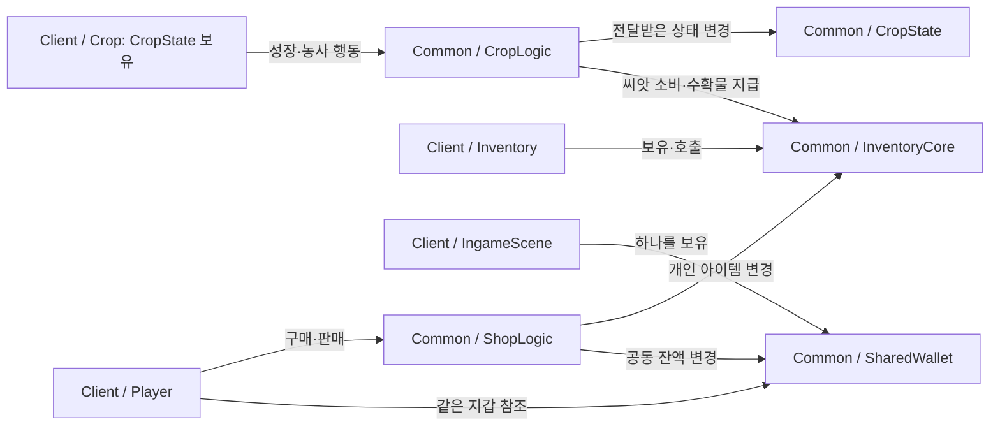

# Crop · Inventory · Shop 공용 로직

Crop·Inventory·Shop의 핵심 상태와 처리 규칙을 `Common`으로 분리했다. 현재 클라이언트가 이 코드를 호출해 기존 로컬 동작을 유지하며, 이후 서버가 서버 소유 상태에 같은 규칙을 적용할 수 있도록 구성했다.

공용 로직 분리에 이어 2026-11-06에 개인 아이템과 공동 지갑을 분리했다. **InventoryCore는 개인 아이템만, SharedWallet은 월드의 잔액만 관리한다. 서버 상태 구성·요청 처리·결과 동기화는 후속 작업이다.**

## 1. 목적과 현재 단계

기존에는 클라이언트 클래스에 게임 규칙과 화면 처리가 함께 있었다. 이번 작업에서는 수량·가격·농사 상태를 변경하는 코드를 화면 코드에서 꺼냈다.

| 구분 | 현재 상태 |
| --- | --- |
| 공통 타입, 인벤토리, 구매·판매, 작물 상태·성장·농사 행동 | `Common`에 분리했고 클라이언트에서 실제 사용 중 |
| 입력, 상호작용 대상 선택, 모델, UI, 파티클, 로그 | 클라이언트에서 담당 |
| 인벤토리와 작물 상태의 소유·변경 | 현재 클라이언트에서 담당 |
| 서버 프로젝트 등록 | InventoryCore·SharedWallet·ShopLogic·CropLogic 소스를 등록해 컴파일함. 실제 서버 월드·플레이어 연결은 후속 작업 |
| 공동 지갑 | SharedWallet 모듈 구현. 현재 클라이언트는 IngameScene의 지갑 하나를 사용 |
| 서버 상태 보관, 패킷 송수신, 동시 처리 보호 | 서버 연결 단계에서 진행 |

`Common`은 현재 별도 라이브러리 프로젝트가 아니다. 클라이언트 프로젝트가 공용 `.cpp` 파일을 직접 컴파일한다. 서버 프로젝트에는 `InventoryCore.cpp`, `SharedWallet.cpp`, `ShopLogic.cpp`, `CropLogic.cpp`와 관련 헤더가 등록되어 있다. 클라이언트와 같은 Common 원본을 참조하고 서버에서도 컴파일한다. 서버의 `main`에서 상태를 생성하거나 패킷에 연결하는 처리는 아직 없다.

## 2. 파일별 역할

```text
Common/
├── GameTypes.h       아이템 ID와 작물 설정 데이터
├── InventoryCore.h   인벤토리 데이터와 조작 API
├── InventoryCore.cpp 개인 아이템 수량 추가·소비·조회
├── SharedWallet.h    공동 재화 인터페이스
├── SharedWallet.cpp  잔액·입금·지출 검증
├── ShopLogic.h       거래 함수와 TradeResult
├── ShopLogic.cpp     구매·판매 계산과 인벤토리 변경
├── CropState.h       작물의 현재 상태
├── CropLogic.h       농사 함수와 ActionResult
├── CropLogic.cpp     성장, 밭갈이, 파종, 물주기, 수확
└── README.md         구조와 서버 연결 시 참고 사항
```

| 파일 | 담당하는 내용 | 관련 클라이언트 코드 |
| --- | --- | --- |
| [GameTypes.h](GameTypes.h) | `ItemID`, `EItemID`, `CropData` | [GameTypes.h](../Client/MiniFarm/Source/Game/GameTypes.h)는 공용 헤더를 포함하고 모델·텍스처 경로인 `ObjectInfo`만 정의 |
| [InventoryCore.h](InventoryCore.h) / [.cpp](InventoryCore.cpp) | 개인 아이템 수량 보관·검증 | [Inventory](../Client/MiniFarm/Source/Game/Inventory.cpp)가 Core를 보유하고 아이템 UI 제공 |
| [SharedWallet.h](SharedWallet.h) / [.cpp](SharedWallet.cpp) | 월드 공동 잔액 보관·검증 | IngameScene이 하나를 보유하고 Player가 참조. 돈 UI·상점·보트가 같은 지갑 사용 |
| [ShopLogic.h](ShopLogic.h) / [.cpp](ShopLogic.cpp) | 가격 계산, 결제, 아이템 지급·회수 | [Player](../Client/MiniFarm/Source/Game/Player.cpp)가 데이터 조회와 결과 로그 담당 |
| [CropState.h](CropState.h) | 작물 종류, 성장 단계, 물, 성장 시간 | [Crop](../Client/MiniFarm/Source/Game/Crop.h)이 상태 보유 |
| [CropLogic.h](CropLogic.h) / [.cpp](CropLogic.cpp) | 작물 상태 판정·변경, 씨앗 소비, 수확물 지급 | [Crop](../Client/MiniFarm/Source/Game/Crop.cpp)이 함수 호출과 모델·효과·진행 바 처리 |

`Common`은 표준 C++ 타입을 사용하며 `Player`, `GameObject`, OpenGL, `DataTable`, 클라이언트 PCH에 의존하지 않는다. `CropData::stageTypes`에는 단계별 표시 키 문자열이 남아 있지만, 실제 모델·텍스처 로딩은 클라이언트에서 처리한다.

## 3. 변경 전후 구조

| 기존 클래스 | 분리 전 | 분리 후 |
| --- | --- | --- |
| `Inventory` | 아이템·돈 데이터, 수량 계산, UI를 함께 처리 | 개인 아이템은 InventoryCore에 위임. 돈은 IngameScene 소유 SharedWallet으로 분리 |
| `Player` | 구매·판매 가격 계산과 돈·아이템 변경을 직접 처리 | 작물 데이터를 찾고 `ShopLogic`을 호출한 뒤 결과 로그 표시 |
| `Crop` | 상태, 성장·농사 판정, 모델·파티클·진행 바를 함께 처리 | `CropState`를 보유하고 `CropLogic`에 판정·변경을 위임한 뒤 화면 갱신 |



아이템은 `Player → Inventory → InventoryCore`, 밭은 `Crop → CropState`, 공동 잔액은 `IngameScene → SharedWallet`이 보유한다. Player는 지갑을 소유하지 않고 생성자에서 같은 지갑의 참조를 받는다. 서버 연결 시에는 GameWorld가 SharedWallet 하나를 보유하고 플레이어별 Inventory와 함께 거래에 전달해야 한다. Common 함수는 전달받은 객체를 직접 변경한다. 함수 호출은 같은 클라이언트 프로세스 안에서 이루어지며, 현재 네트워크 요청을 보내지는 않는다.

### 구매 흐름

```text
Shop::Buy(player)
  → Player::BuySeed(seedID, count)
      → 씨앗에 맞는 CropData 조회
      → ShopLogic::BuySeed(inventory.Core(), sharedWallet, seedID, count, data)
          → 가격 검증 → Inventory·지갑 복사본에서 처리 → 모두 성공하면 두 원본에 반영
      → TradeResult에 따라 로그 표시
```

판매도 `Player::SellCrop()`에서 `ShopLogic::SellCrop()`을 호출한다. 공용 함수가 아이템 사용과 판매 대금 지급을 처리한다. 클라이언트의 `Shop`은 상점 UI와 구매·판매 진입을 담당한다.

### 파종 흐름

```text
Crop::OnInteract(player)
  → 장착한 씨앗 종류 확인
  → CropLogic::Plant(m_state, player->GetInventory().Core(), seedID)
      → 갈린 밭인지 확인 → 씨앗 소비 → 작물 상태 초기화
  → 성공하면 RefreshModelFromState()와 로그 처리
```

### 수확 흐름

```text
Crop::OnInteract(player)
  → 낫 장착 확인, 현재 작물의 CropData 조회
  → CropLogic::Harvest(m_state, player->GetInventory().Core(), data)
      → 성장 단계 판정 → 수확물 1개 지급 → 갈린 밭으로 초기화
  → 성공하면 RefreshModelFromState()와 로그 처리
```

공용 함수가 이미 아이템을 소비·지급하므로, 성공 후 클라이언트에서 같은 처리를 다시 하지 않는다. 물주기도 `CropLogic::Water()`가 물을 추가하고, 클라이언트는 성공 시 파티클과 행동 애니메이션을 처리한다.

## 4. 데이터와 함수 사용 조건

### 상태와 설정 데이터

| 데이터 | 의미와 기본값 |
| --- | --- |
| `CropState::id` | 현재 작물/땅 종류, 기본 `Empty` |
| `CropState::level` | 0부터 시작하는 성장 단계, 기본 0 |
| `CropState::water` | 현재 물, 기본 0 |
| `CropState::growTime` | 누적 성장 시간, 초 단위, 기본 0 |
| `CropState::requiredGrowTime` | 한 단계 성장에 필요한 시간, 초 단위, 기본 3 |
| `CropData` | 이름, 씨앗 가격, 판매 가격, 단계 키, 단계별 필요 물을 담은 설정 |
| `InventoryCore` | 기본 아이템 없음. 돈은 보관하지 않음 |
| `SharedWallet` | 기본 잔액 0. 월드당 하나를 생성하고 새 플레이어가 들어와도 초기화하지 않음 |

현재 테스트용 시작 아이템은 클라이언트 `Inventory` 생성자가 지급한다. `InventoryCore`를 서버에서 생성해도 시작 아이템이 자동으로 생기지 않는다.

작물 설정은 현재 클라이언트 [DataTable](../Client/MiniFarm/Source/Systems/DataTable.cpp)이 [crops.csv](../Client/MiniFarm/Data/crops.csv)에서 읽는다. Common 함수에는 호출자가 해당 작물에 맞는 `CropData`를 전달한다. 클라이언트 `DataTable::GetCrop()`은 없는 ID를 새로 삽입하지 않고 nullptr를 반환하며, 거래·수확 호출부가 설정 누락을 실패로 처리한다.

### 농사 함수

| 함수 | 현재 처리 |
| --- | --- |
| `ResetState(state, id, level)` | 종류·단계 지정, 물·성장 시간 0, 필요 성장 시간 3초로 초기화 |
| `Till(state)` | `Empty`이면 `Tilled`로 초기화 |
| `Plant(state, inventory, seedID)` | 갈린 밭에 당근/양배추 씨앗 1개를 소비하고 해당 작물로 초기화 |
| `AddWater(state, amount)` | 조건 검사 없이 지정량을 더하는 보조 함수 |
| `Water(state)` | 빈 땅·갈린 밭을 제외하고 물 5 추가 |
| `Harvest(state, inventory, data)` | 마지막 단계와 일치하고 아이템 1개 지급에 성공하면 갈린 밭으로 초기화. 수량 제한으로 지급 실패 시 밭 유지 |
| `UpdateGrowth(state, data, dt)` | 물 조건과 시간에 따라 성장 계산. 단계가 바뀌면 `true` 반환 |

`ActionResult`는 기존 `Success`, `NotApplicable`, `NoSeed`에 수확 실패 사유인 `NotMature`(성장 중), `InventoryLimitExceeded`(수량 한도), `InvalidState`(잘못된 작물 종류·단계), `InvalidData`(비어 있거나 불완전한 성장 설정)를 추가했다. 빈 땅·갈린 밭의 수확은 `NotApplicable`이다. 실패 시 Inventory와 밭의 종류·단계·물·성장 시간을 모두 유지한다. 요청자·거리·도구 검증까지 끝났다는 의미는 아니다.

`UpdateGrowth()`의 `dt` 인자는 **밀리초**이며, 내부에서 초로 변환해 `growTime`에 더한다. 호출자는 유효한 성장 단계와 그 단계에 대응하는 `stageTypes`, `waterStages`를 제공해야 한다.

### 거래 함수

`ShopLogic::BuySeed()`와 `SellCrop()`은 개인 `InventoryCore&`와 공동 `SharedWallet&`를 전달받아 `TradeResult { success, totalPrice, reason }`를 반환한다. 두 복사본에서 처리한 뒤 모두 성공하면 반영하므로 실패 시 개인 아이템과 공동 잔액이 유지된다. 구매 실패 시 계산 가능한 가격은 `totalPrice`로 반환하고 잘못된 입력·가격 계산 실패는 0, 판매 실패는 0이다. `reason`은 성공 시 `TradeFailure::None`, 실패 시 잘못된 아이템·수량·가격, 가격 곱셈 초과, 잔액·보유량 부족, 아이템·잔액 한도를 구분한다. Player는 실패 사유를 Debug 빌드의 콘솔에만 남긴다. 실패 처리에서 상점 안내 문자열을 변경하지 않으므로 B/S/X 메뉴와 배치는 유지된다. 이 처리는 스레드 동기화를 제공하지 않으며 서버는 거래 전체를 한 실행 흐름 또는 같은 보호 범위에서 처리해야 한다.

아이템은 씨앗·수확물 네 종류만, 수량은 양수만 허용하며 int 범위 초과와 보유량 부족을 거부한다. 지갑은 음수 금액·잔액 초과·int 범위 초과를 거부하며 금액 0은 허용한다. 거래는 대상 종류와 수량·가격 곱셈도 검증한다. 호출자는 해당 작물에 맞는 CropData를 제공하고 요청자·거리·권한을 검증해야 한다.

`Inventory::Core()`는 기존 클라이언트가 공용 함수에 내부 Core를 전달하기 위한 접근점이다. 네트워크 전환 시 이 경로를 포함해 클라이언트의 상태 변경 호출을 정리해야 한다.

### 실제 게임에서 실패 처리 확인

1. 서버 솔루션을 Debug/x64로 먼저 실행하고, 별도 Visual Studio에서 클라이언트 솔루션을 Debug/x64로 실행한다. 스페이스바로 접속한다.
2. c 키를 누르지 않은 초기 잔액 0에서 상점에 E로 접근한 뒤 B를 누른다. Debug 콘솔에 `Not enough money.`가 출력되고 돈과 씨앗은 유지되어야 한다. 인게임 상점 메뉴는 바뀌지 않아야 한다.
3. 상점에서 시작 수확물을 S로 판매한 뒤 다시 S를 누른다. Debug 콘솔에 `Not enough crops.`가 출력되고 두 번째 요청에서는 돈과 수량이 유지되어야 한다.
4. c 키로 공동 재화를 추가하고 B로 구매에 성공하는지 확인한다. 성공·실패를 반복해도 상점 메뉴와 화면 배치는 같아야 한다.
5. 밭에 1(밭갈이 도구)+E, 4(당근 씨앗)+E로 파종한 뒤 물을 주기 전에 3(낫)+E로 수확을 시도한다. 콘솔의 `Harvest failed: Crop is not mature.`와 작물·수확물 수량 유지를 확인한다. 빈 땅이나 갈린 밭에서는 `No crop to harvest.`가 출력된다.

수확의 잘못된 상태·설정·수량 한도는 공용 Harvest 함수에서 각각 거부한다. 수확 실패는 Debug 콘솔 로그로만 안내하며 인게임 문구·팝업·조작 모드를 추가하지 않는다. 실제 서버 판정·패킷 동기화는 후속 작업이다.

### 초기화와 화면 갱신 구분

`Crop::SetCropState()`는 `ResetState()`와 `RefreshModelFromState()`를 함께 호출하므로 물과 성장 시간이 초기화된다. `SetCropID()`는 ID만 바꾸며 전체 상태 적용이나 모델 갱신을 수행하지 않는다.

성장 후에는 `RefreshModelFromState()`로 모델만 바꿔 남은 물을 유지한다. 서버에서 받은 전체 상태를 적용할 때도 **수신 상태를 보존하는 적용 경로와 화면 갱신 경로**가 필요하다. 현재 그 경로는 미구현이며, `SetCropState()`로 대신하면 수신한 물과 시간이 사라진다.


## 5. 협업과 머지 시 참고

`Player::BuySeed()`, `SellCrop()`, `Crop::OnInteract()` 호출은 유지한다. Player 생성자는 SharedWallet 참조를 요구하고, ShopLogic도 지갑 참조를 요구한다. Inventory와 InventoryCore의 돈 API는 제거했으며 AddItem은 성공 여부를 반환한다. 이동·입력·오브젝트 생성 코드를 크게 바꾸지 않으면서 내부 처리를 공용 코드로 연결하기 위한 구조다.

| 변경 위치 | 머지 시 확인할 내용 |
| --- | --- |
| `Common/` | 공통 타입 정의와 규칙 구현을 함께 유지. 새로운 판정을 클라이언트에 중복 구현하지 않기 |
| `Player.cpp` | 다른 팀원의 이동·네트워크 변경과 구매·판매 호출을 함께 보존. 공용 함수 호출 후 추가 차감·지급하지 않기 |
| `Crop.cpp` / `.h` | 공용 판정 호출과 상태 보유 구조를 유지하고, 새 네트워크 상태 적용 경로에서 모델 갱신과 상태 초기화를 구분 |
| `MiniFarm.vcxproj` | 공용 `.cpp`/헤더 등록, 공용 `.cpp`의 PCH 미사용 설정, 기존 빌드 설정 보존 |
| 포함 디렉터리 | `$(ProjectDir)..\..`와 다른 브랜치가 추가한 경로를 함께 유지. 예를 들어 `$(ProjectDir)`가 추가됐다면 두 경로 모두 필요할 수 있음 |
| `MiniFarm.vcxproj.filters` | Common 파일의 솔루션 탐색기 표시 항목과 다른 팀원의 추가 파일을 함께 유지 |

기존 파일의 인코딩·줄바꿈 전체를 바꾸면 관계없는 줄까지 충돌할 수 있으므로 필요한 부분만 수정한다. Common에는 화면·입력·소켓·세션 처리 의존성을 추가하지 않고, 서버의 요청 검증과 동기화는 서버 호출부에서 담당하도록 역할을 유지한다.
